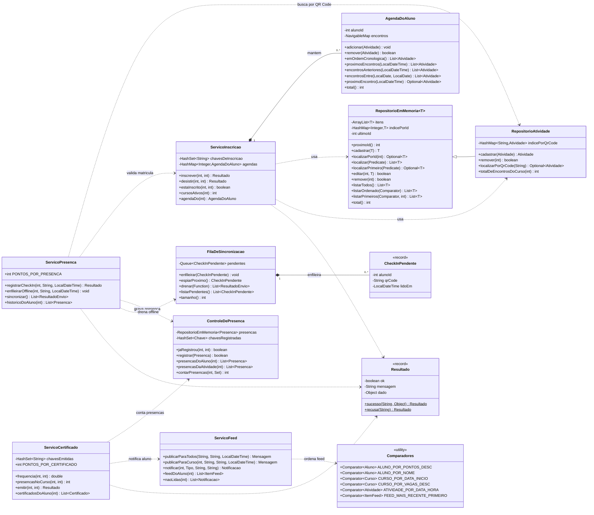

# Diagrama de Classes Completo — Próxima Etapa (Entrega 2)

UC **Programação Orientada a Objetos e Estrutura de Dados**.

Contempla as 13 classes de domínio pedidas — `Aluno`, `Curso`, `Atividade`,
`Inscricao`, `Presenca`, `Certificado`, `Card`, `TestePerfil`, `Pergunta`,
`Alternativa`, `ResultadoPerfil`, `Mensagem` e `Notificacao` — mais a interface
`Identificavel` e a superclasse abstrata `ItemFeed`, criadas nesta entrega.

Código correspondente:
[`src/Entrega 2/POO-EstruturaDados`](../../../src/Entrega%202/POO-EstruturaDados) ·
Modelo de dados de origem:
[`schema.sql`](../../../src/Entrega%202/Backend/db/schema.sql)

---

## 1. Modelo de domínio

```mermaid
classDiagram
    direction TB

    class Identificavel {
        <<interface>>
        +getId() int
    }

    class ItemFeed {
        <<abstract>>
        -int id
        -String titulo
        -String corpo
        -LocalDateTime criadoEm
        +getTitulo() String
        +getCorpo() String
        +getCriadoEm() LocalDateTime
        +rotuloTipo()* String
        +linhaDoFeed() String
        #resumoDoCorpo(int) String
    }

    class Aluno {
        -int id
        -String nome
        -String email
        -String senhaHash
        -String escola
        -String serie
        -String cidade
        -int pontos
        -Nivel nivel
        -String avatarUrl
        -LocalDateTime criadoEm
        +getId() int
        +setNome(String) void
        +setEscola(String) void
        +adicionarPontos(int) void
        +getNivel() Nivel
    }

    class Curso {
        -int id
        -String titulo
        -String descricao
        -String categoria
        -String local
        -int cargaHoraria
        -LocalDate dataInicio
        -LocalDate dataFim
        -int vagasTotais
        -int vagasDisponiveis
        -boolean possuiCertificado
        -boolean ativo
        +getId() int
        +temVaga() boolean
        +ocuparVaga() boolean
        +liberarVaga() boolean
        +getVagasOcupadas() int
    }

    class Atividade {
        -int id
        -int cursoId
        -String titulo
        -LocalDate data
        -LocalTime horaInicio
        -LocalTime horaFim
        -String local
        -String qrCode
        +getId() int
        +getQrCode() String
        +getDataHoraInicio() LocalDateTime
        +getDuracaoMinutos() long
        +remarcar(LocalDate, LocalTime, LocalTime) void
        +jaOcorreu(LocalDateTime) boolean
    }

    class Inscricao {
        -int id
        -int alunoId
        -int cursoId
        -Status status
        -LocalDateTime criadoEm
        +getId() int
        +chaveUnica() String
        +iniciar() void
        +concluir() boolean
        +desistir() boolean
        +estaAtiva() boolean
    }

    class Presenca {
        -int id
        -int alunoId
        -int atividadeId
        -LocalDateTime registradoEm
        -boolean sincronizadaOffline
        +getId() int
        +chaveUnica() Chave
        +isSincronizadaOffline() boolean
    }

    class Chave {
        <<record>>
        -int alunoId
        -int atividadeId
    }

    class Certificado {
        -int id
        -int alunoId
        -int cursoId
        -int presencasRegistradas
        -int totalDeEncontros
        -String certificadoUrl
        -LocalDateTime emitidoEm
        +double FREQUENCIA_MINIMA
        +emitir(int, int, int, int, int)$ Certificado
        +calcularFrequencia(int, int)$ double
        +atendeCriterioDeFrequencia(int, int)$ boolean
        +getFrequencia() double
    }

    class Card {
        -int id
        -String codigoCard
        -String nomeAluno
        -String escola
        -String serie
        -int pontos
        -Nivel nivel
        -int cursosAtivos
        -LocalDate validoDesde
        +paraAluno(Aluno, int)$ Card
        +getCodigoCard() String
    }

    class TestePerfil {
        -int id
        -String titulo
        -String descricao
        -TreeMap~Integer,Pergunta~ perguntasPorOrdem
        +getId() int
        +adicionarPergunta(Pergunta) TestePerfil
        +getPerguntasEmOrdem() List~Pergunta~
        +localizarPorOrdem(int) Optional~Pergunta~
        +localizarPorId(int) Optional~Pergunta~
        +apurar(int, int, Map) ResultadoPerfil
    }

    class Pergunta {
        -int id
        -String texto
        -int ordem
        -LinkedHashMap~Integer,Alternativa~ alternativasPorId
        +getId() int
        +adicionarAlternativa(Alternativa) Pergunta
        +localizarAlternativa(int) Optional~Alternativa~
        +getAlternativas() List~Alternativa~
    }

    class Alternativa {
        -int id
        -int perguntaId
        -String texto
        -Perfil perfil
        +getId() int
        +getPerfil() Perfil
    }

    class ResultadoPerfil {
        -int id
        -int alunoId
        -TreeMap~Integer,Integer~ respostas
        -Perfil perfilResultado
        -EnumMap~Perfil,Integer~ contagem
        -String descricao
        -LocalDateTime concluidoEm
        +getId() int
        +getPerfilResultado() Perfil
        +getContagemFormatada() Map~String,Integer~
        +getAviso() String
    }

    class Mensagem {
        -Destinatario destinatarioTipo
        -Integer cursoId
        +paraTodos(int, String, String, LocalDateTime)$ Mensagem
        +paraCurso(int, String, String, int, LocalDateTime)$ Mensagem
        +ehParaTodos() boolean
        +rotuloTipo() String
    }

    class Notificacao {
        -int alunoId
        -Integer mensagemId
        -Tipo tipo
        -boolean lida
        +deMensagem(int, int, Mensagem)$ Notificacao
        +marcarComoLida() boolean
        +rotuloTipo() String
        +linhaDoFeed() String
    }

    class Nivel {
        <<enumeration>>
        EXPLORADOR
        APRENDIZ
        DESTAQUE
        EMBAIXADOR
        +paraPontos(int)$ Nivel
    }

    class Status {
        <<enumeration>>
        INSCRITO
        CURSANDO
        CONCLUIDO
        DESISTENTE
    }

    class Perfil {
        <<enumeration>>
        EXATAS
        HUMANAS
        SAUDE
        ARTES
        INDEFINIDO
    }

    class Destinatario {
        <<enumeration>>
        TODOS
        CURSO
    }

    class Tipo {
        <<enumeration>>
        MENSAGEM
        CURSO_NOVO
        AGENDA
        CERTIFICADO
    }

    Identificavel <|.. Aluno
    Identificavel <|.. Curso
    Identificavel <|.. Atividade
    Identificavel <|.. Inscricao
    Identificavel <|.. Presenca
    Identificavel <|.. Certificado
    Identificavel <|.. Card
    Identificavel <|.. TestePerfil
    Identificavel <|.. Pergunta
    Identificavel <|.. Alternativa
    Identificavel <|.. ResultadoPerfil
    Identificavel <|.. ItemFeed

    ItemFeed <|-- Mensagem
    ItemFeed <|-- Notificacao

    Aluno "1" --> "0..*" Inscricao : possui
    Curso "1" --> "0..*" Inscricao : recebe
    Curso "1" --> "0..*" Atividade : programa
    Aluno "1" --> "0..*" Presenca : registra
    Atividade "1" --> "0..*" Presenca : gera
    Aluno "1" --> "0..*" Certificado : conquista
    Curso "1" --> "0..*" Certificado : origina
    Aluno "1" --> "1" Card : projeta
    Aluno "1" --> "0..*" ResultadoPerfil : responde
    Aluno "1" --> "0..*" Notificacao : recebe
    Curso "0..1" --> "0..*" Mensagem : direciona
    Mensagem "1" --> "0..*" Notificacao : entrega
    TestePerfil "1" *-- "1..*" Pergunta : compoe
    Pergunta "1" *-- "2..*" Alternativa : oferece
    TestePerfil ..> ResultadoPerfil : apura
    Presenca "1" *-- "1" Chave : identidade

    Aluno ..> Nivel
    Inscricao ..> Status
    Alternativa ..> Perfil
    ResultadoPerfil ..> Perfil
    Mensagem ..> Destinatario
    Notificacao ..> Tipo
```

### Legenda dos relacionamentos

| Relacionamento | Multiplicidade | Leitura |
|---|---|---|
| `Aluno` — `Inscricao` | 1 para 0..* | Um aluno pode ter várias inscrições; cada inscrição é de um único aluno. |
| `Curso` — `Inscricao` | 1 para 0..* | Um curso recebe várias inscrições. O par (aluno, curso) é **único** (`UNIQUE(aluno_id, curso_id)`), então um aluno aparece no máximo uma vez por curso. |
| `Curso` — `Atividade` | 1 para 0..* | Um curso programa vários encontros; um encontro pertence a um único curso. |
| `Aluno` — `Presenca` — `Atividade` | 1 para 0..* dos dois lados | `Presenca` é a tabela associativa do check-in. O par (aluno, atividade) é **único**: uma presença por encontro. |
| `Aluno` / `Curso` — `Certificado` | 1 para 0..* | Um certificado liga um aluno a um curso, com o par **único** e emissão condicionada a 75% de frequência. |
| `Aluno` — `Card` | 1 para 1 | O card é uma **projeção** calculada do aluno (não é tabela): mesmo id, dados resumidos. |
| `Aluno` — `ResultadoPerfil` | 1 para 0..* | O aluno pode refazer o teste; cada execução vira um resultado no histórico. |
| `TestePerfil` — `Pergunta` | 1 para 1..* (composição) | As perguntas só existem dentro do teste; são guardadas em `TreeMap` indexado pela ordem. |
| `Pergunta` — `Alternativa` | 1 para 2..* (composição) | Cada pergunta oferece ao menos duas alternativas; cada alternativa pontua para um `Perfil`. |
| `Curso` — `Mensagem` | 0..1 para 0..* | Comunicado geral não tem curso (`cursoId` nulo); comunicado de turma aponta para um curso. |
| `Mensagem` — `Notificacao` | 1 para 0..* | Publicar um comunicado gera uma notificação individual por destinatário. |
| `Aluno` — `Notificacao` | 1 para 0..* | Toda notificação tem um dono e um estado lida/não lida. |
| `Presenca` — `Chave` | 1 para 1 (composição) | `record` interno com (alunoId, atividadeId); é o elemento do `HashSet` que barra a duplicidade. |

### Herança e interface no diagrama

- `Identificavel` (`<<interface>>`) é implementada por **todas** as entidades,
  o que permite ao repositório genérico `RepositorioEmMemoria<T extends
  Identificavel>` extrair o id sem conhecer o tipo concreto.
- `ItemFeed` (`<<abstract>>`) é a superclasse de `Mensagem` e `Notificacao`:
  concentra título, corpo, data e a montagem da linha do feed. O método
  `rotuloTipo()` é abstrato (marcado com `*`) e cada subclasse o implementa —
  é o ponto de despacho polimórfico do feed unificado.

---

## 2. Camada de estruturas de dados e serviços

### Legenda da camada de dados

| Classe | Estrutura central | Papel no domínio | Complexidade |
|---|---|---|---|
| `RepositorioEmMemoria<T>` | `ArrayList` + `HashMap` | Ordem de cadastro + índice por id para todas as entidades | localizar O(1); listar/filtrar O(n); ordenar O(n log n) |
| `RepositorioAtividade` | herda o anterior e acrescenta `HashMap<String, Atividade>` | Achar o encontro pelo QR Code lido no check-in | O(1) |
| `AgendaDoAluno` | `TreeMap<LocalDateTime, List<Atividade>>` | Agenda sempre cronológica e consultas de intervalo (`tailMap`, `headMap`, `subMap`) | inserir e consultar O(log n) |
| `ControleDePresenca` | `HashSet<Presenca.Chave>` | Espelha `UNIQUE(aluno_id, atividade_id)`: recusa presença duplicada | O(1) |
| `FilaDeSincronizacao` | `Queue` sobre `LinkedList` | Check-ins feitos offline sobem na ordem exata das leituras (FIFO) | `offer`/`poll` O(1) |
| `Comparadores` | `Comparator<T>` | Ranking por pontos, cursos por data ou vagas, feed por recência | O(n log n) na ordenação |
| `ServicoInscricao` | `HashSet` de `alunoId:cursoId` + `HashMap` de agendas | Vaga, duplicidade de inscrição e montagem da agenda | O(1) nas verificações |
| `ServicoCertificado` | `Set<Integer>` de encontros do curso | Frequência mínima de 75% e unicidade do certificado | O(k), k = encontros do curso |

> **Herança na camada de dados:** `RepositorioAtividade` estende
> `RepositorioEmMemoria<Atividade>` e sobrescreve `cadastrar` e `remover`
> (chamando `super`) para manter o índice extra por QR Code sincronizado com a
> lista e com o índice por id.

---

## Como visualizar

- **No GitHub:** este arquivo já renderiza os diagramas ao ser aberto no
  navegador.
- **Fora do GitHub:** cole o conteúdo de um bloco `mermaid` em
  <https://mermaid.live>.
